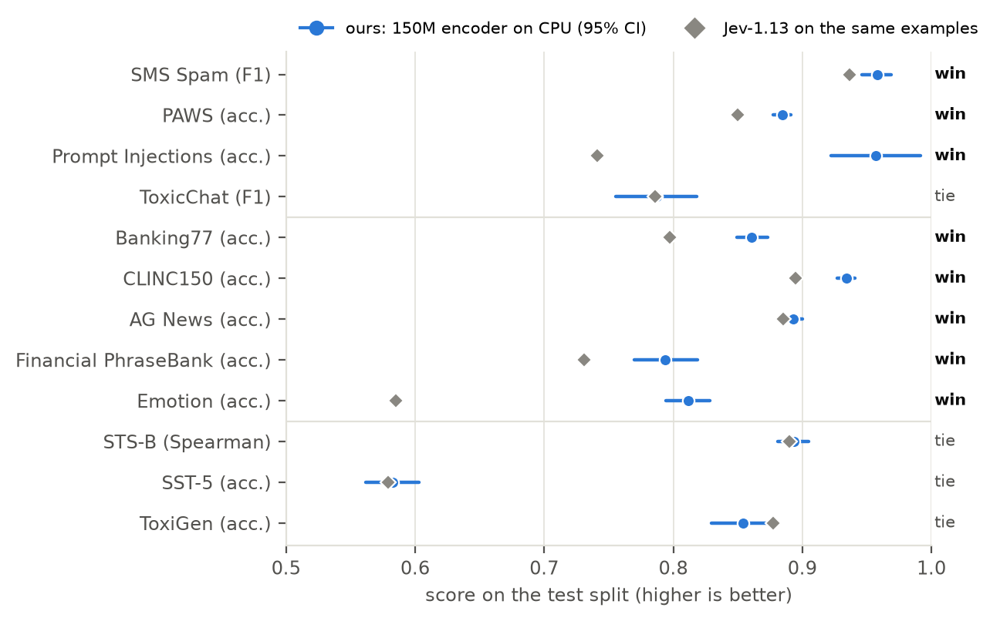
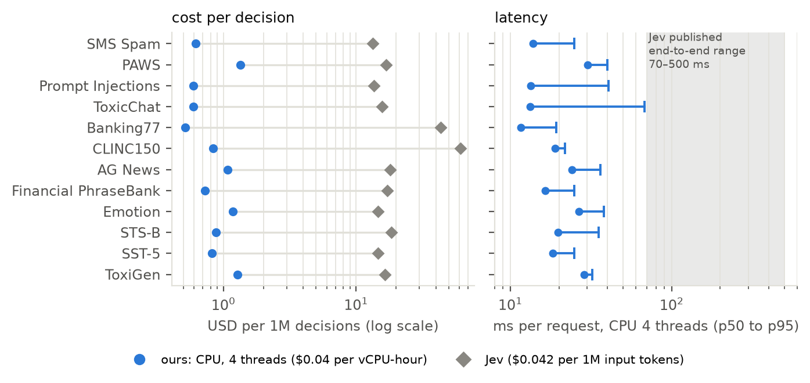
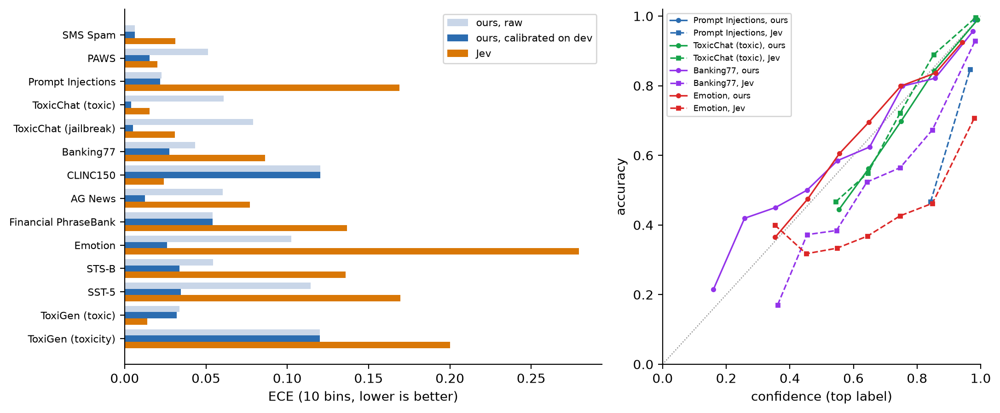
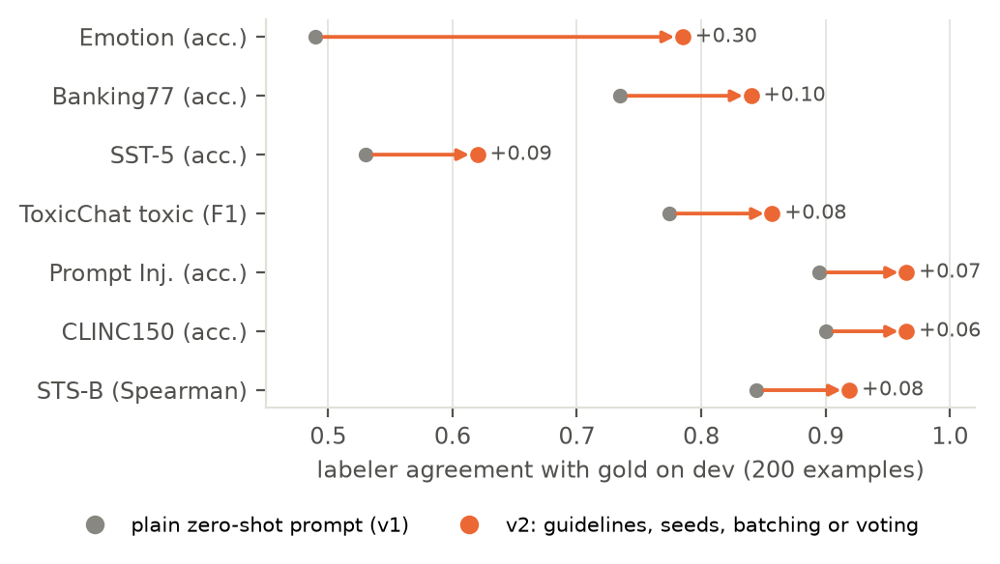

# ownyourjev: you don't need Jev

[Jev](https://openrouter.ai/docs/guides/community/jev) is a hosted decision model. You send text and typed questions, and it answers:

- **noul:** is this true?
- **choice:** which of these options?
- **score:** where does it fall on this scale?

You pay per call, wait 70–500 ms, and send your data to someone else's API.

**You can own that model instead, and it holds up.** A cheap LLM labels your own unlabeled text. You hand-label 220 examples. A 150M-parameter encoder trained on the result runs on a commodity CPU. We tested it on 12 tasks from the published Jev benchmark, scored on exactly the examples Jev was scored on. It matches or beats Jev on every property Jev sells:

| | Jev (hosted) | Your own model (CPU) |
|---|---|---|
| Accuracy | — | **wins on 8 tasks, ties on 4, loses on none** |
| Calibrated probabilities (ECE, lower is better) | median 0.086 | **median 0.027, better on 12 of 14 questions** |
| Latency per request | 70–500 ms end-to-end | **12–30 ms median, ≤ 68 ms p95** on 4 CPU threads |
| Cost per 1M decisions | $13–$61 | **$0.52–$1.34**, 12–84× cheaper |
| One-time cost to build | — | **$0.15–$2.57 per task**, including every failed experiment |
| Pays for itself after | — | **4k–181k decisions** |
| Runs where | their API | your machine; no network, no data leaving, no version drift |

The paper is [*You Don't Need Jev*](paper/main.pdf), with every experiment, failure and test-set scoring documented.



## Why own your decision model

- **Accuracy you can improve.** Jev is zero-shot and reads your question the way it reads everyone's. Your model learns *your* labeling convention. That convention is where the biggest wins came from: Emotion 0.811 vs Jev 0.585, Prompt Injections 0.957 vs 0.741, Banking77 0.861 vs 0.797.
- **Cost that doesn't scale with traffic.** At $0.04 per vCPU-hour, a million decisions cost about a dollar of CPU.
- **Probabilities you can trust.** Calibrate on the same 200 dev examples with one command. The result is better calibrated than Jev on 12 of 14 questions. Jev is badly overconfident on several tasks (Emotion ECE 0.279, Prompt Injections 0.169); ours are 0.026 and 0.022.
- **Latency without the network.** The slowest model answers in 68 ms at p95 on 4 CPU threads, below Jev's best published case.
- **No dependency.** No API key, no rate limits, no outage, no silent model update, and your data stays on your machine.
- **The same interface.** `ownyourjev serve` speaks Jev's request and response schema (`POST /v1/systemone`), so switching is a URL change.





## How to build a better, cheaper Jev for your task

The recipe below is distilled from 318 logged experiments. It takes an afternoon of labeling and a few dollars of LLM calls. The [paper](paper/main.pdf) has the evidence for each step.

**1. Write the question exactly as you would for Jev, and hand-label about 220 examples:** 20 *seeds* and 200 *dev*.

```json
{"questions": {"team": {"type": "choice", "instructions": "Which team should handle this support `ticket`?",
  "criteria": {"billing": "Invoices, refunds, payment methods.", "technical": "Bugs, errors, outages.",
               "account": "Login, password, permissions.", "sales": "Pricing, upgrades, quotes."}}}}
```

**2. Write labeling guidelines. This is the biggest lever.**
- Label your seeds and dev set with a cheap LLM, read its mistakes, and write down your conventions.
- Re-check on the half of dev you didn't read. Stop when agreement stops rising; that number predicts your ceiling.
- In our experiments, guidelines raised labeler agreement with gold by 6–30 points.
- Frontier labelers rarely beat a cheap labeler with good guidelines.



**3. Label your whole unlabeled pool.**
- A flash-class model costs roughly $0.10–$0.30 per 10k texts.
- Use soft labels for noisy or ordinal questions.
- If two cheap labelers disagree often, average them.

```bash
uv run ownyourjev label spec.json pool.jsonl --seeds seeds.jsonl --guidance guidelines.txt --soft --out data/labels.jsonl
```

**4. Add synthetic data only where real data is missing.**
- Examples: rare classes, out-of-scope inputs, under-covered similarity levels.
- It fixed CLINC150's out-of-scope recall (dev 0.81 → 0.935).
- It hurt wherever it didn't look like the real inputs.

```bash
uv run ownyourjev synth spec.json --n 1000 --domain "customer support tickets" --state-fields ticket --seeds seeds.jsonl
```

**5. Train a 150M encoder and let the search pick the recipe.**

```bash
uv run ownyourjev train  spec.json data/labels.jsonl --qid team --backbone gte-modernbert --method full --soft --out models/team
uv run ownyourjev search spec.json data/labels.jsonl --qid team --out runs/team   # backbone × method × data size × HPO
```

- Bigger backbones didn't help in our experiments.
- Averaging 3 fine-tunes that share an initialization removes seed variance for free.

**6. Export for CPU.**

```bash
uv run ownyourjev export models/team   # ONNX int8; MLP output projections kept fp32 (keeps accuracy)
```

**7. Calibrate on your dev set and serve.**

```bash
uv run ownyourjev calibrate models/team dev.jsonl   # {"state": ..., "gold": {"team": "billing"}} per line
uv run ownyourjev serve models                      # Jev-compatible POST /v1/systemone
```

- `calibrate` picks a calibrator by cross-validated log-loss and saves it next to the model; `predict` and `serve` apply it automatically.
- For choice and score questions it only uses temperature scaling, which never changes the answer.
- It predicts one request at a time, as the model is served. Dynamic int8 outputs depend on batching, so evaluate at the batch size you serve.

## Results

These numbers come from a strict protocol:

- Each task gets 220 gold examples from the training split.
- Every choice is made on dev.
- Test labels are read only by an audited script that logs every scoring: 14 scorings across 12 tasks, all reported, plus logged analysis-only reads (calibration, batch-1 serving, de-duplication).
- Jev is `jev-1.13.0`, re-scored from its published per-example responses on the same test examples.

Full table: [`benchmarks/results_v2/RESULTS.md`](benchmarks/results_v2/RESULTS.md).

| Type | Task | Metric | Ours (95% CI) | Jev | |
|---|---|---|---|---|---|
| noul | SMS Spam | F1 | 0.958 (0.946–0.969) | 0.937 | **win** |
| noul | PAWS | acc. | 0.884 (0.877–0.891) | 0.850 | **win** |
| noul | Prompt Injections | acc. | 0.957 (0.922–0.991) | 0.741 | **win** |
| noul | ToxicChat (toxic / jailbreak) | F1 | 0.787 / 0.848 | 0.786 / 0.717 | tie / win |
| choice | Banking77 | acc. | 0.861 (0.849–0.873) | 0.797 | **win** |
| choice | CLINC150 | acc. | 0.934 (0.927–0.941) | 0.895 | **win** |
| choice | AG News | acc. | 0.893 (0.886–0.900) | 0.885 | **win** |
| choice | Financial PhraseBank | acc. | 0.794 (0.770–0.819) | 0.731 | **win** |
| choice | Emotion | acc. | 0.811 (0.794–0.829) | 0.585 | **win** |
| score | STS-B | Spearman | 0.893 (0.881–0.905) | 0.890 | tie |
| score | SST-5 | acc. | 0.583 (0.562–0.603) | 0.579 | tie |
| score | ToxiGen | acc. | 0.854 (0.830–0.878) | 0.878 | tie |

Things you should know:

- **Ties are ties.** On ToxicChat and ToxiGen, removing test inputs that also appear in the training pool tips the result slightly towards Jev ([`dedup_analysis.md`](benchmarks/results_v2/dedup_analysis.md)).
- **The probabilities are calibrated.** A one-parameter calibrator fitted on the same 200 dev examples gives lower expected calibration error than Jev on 12 of 14 heads, with a median of 0.027 vs 0.086. Log-loss is also lower on 12 of 14, and Brier score on 10 of 14. Jev stays better calibrated on ToxiGen's toxic head and on CLINC150 ([`CALIBRATION.md`](benchmarks/results_v2/CALIBRATION.md)).
- **Evaluate the way you serve.** Dynamic int8 outputs depend on which texts share a batch. We re-scored every int8 model one request at a time, as it is served: no verdict changed, but up to 9.5% of decisions moved (Financial PhraseBank).
- **Some task types are in progress.** Reading comprehension and judging generated text (BoolQ, SummEval, HelpSteer2) are not reported yet.
- **The audit trail is in the repo.**
  - Each task's ledger lists every idea tried, including failures: `benchmarks/results_v2/<task>/experiments.jsonl`.
  - The study log records protocol, decisions and incidents: [`PAPER_LOG.md`](benchmarks/results_v2/PAPER_LOG.md).

## Install

```bash
git clone https://github.com/erfaneshrati/ownyourjev && cd ownyourjev
uv sync                      # Python ≥ 3.11; a GPU speeds up training, inference runs on CPU
cp .env.example .env         # OPENROUTER_API_KEY for labeling; OYJ_BUDGET_USD is a hard spend cap
uv run ownyourjev budget     # spend so far (every LLM call is cached and recorded)
```

## Reproduce the benchmark

```bash
uv run python -m benchmarks.v2.final_eval <task>          # the only code that reads test labels (logged)
uv run python -m benchmarks.v2.latency <task> <model_dir> --out latency.json --onnx
uv run python -m benchmarks.v2.report                     # RESULTS.md
uv run python -m benchmarks.v2.calibration_eval <task>    # dev-fitted calibrator vs Jev (logged)
uv run python -m benchmarks.v2.calibration_report         # CALIBRATION.md, paper calibration table and figure
cd paper && tectonic main.tex                             # the paper
```

- The protocol and splits are in `benchmarks/v2/protocol.py`. The agent brief that governed every experiment is `benchmarks/v2/AGENT_BRIEF.md`.
- Per-task experiment code is in `experiments/<task>/`.
- Jev's per-example responses come from [Deußer et al. 2026](https://arxiv.org/abs/2609.37647) ([Zenodo](https://doi.org/10.5281/zenodo.23039006)).

## Layout

```
src/ownyourjev/   spec (Jev schema) · llm (OpenRouter client, cache, spend caps) · label (guidelines, soft labels)
                  synth · data · models · train (frozen/LoRA/full, soft labels) · search · calibrate · evaluate
                  export (ONNX, selective int8) · serve (Jev-compatible API) · gpu (shared-GPU scheduler) · cli
benchmarks/v2/    protocol · final_eval, calibration_eval, batch1_eval (audited) · latency · ledger · report · AGENT_BRIEF.md
benchmarks/results_v2/   RESULTS.md · PAPER_LOG.md · TEST_ACCESS.log · <task>/ (NOTES, ledger, FROZEN, final)
experiments/      per-task experiment code     paper/   "You Don't Need Jev" (LaTeX, figures, tables)
```

## License

MIT. The benchmark task definitions are adapted from [jev-benchmarking](https://github.com/AppliedMachineLearning-Lab/jev-benchmarking) (MIT).
