# ownyourjev benchmark report

Jev numbers are the published zero-shot results of jev-1.13.0 (arXiv:2609.37647, Table 2) on the same evaluation splits. Our models are 150M-parameter encoders trained on labels produced by `deepseek/deepseek-v4.1-flash`; model selection, early stopping and calibration used only held-out LLM labels. `silver` = LLM labels only; `seeded` = LLM labels with 20 gold examples shown in the prompt; `gold` = same recipe on gold labels (upper bound). Bold = our 95% CI lies entirely above Jev's published value.

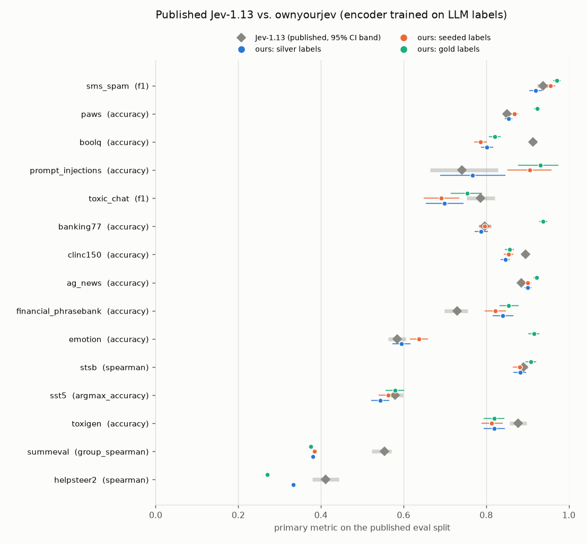

Notes:
- *LLM labels to beat Jev*: the smallest size on the data-size ladder at which a learning curve passes Jev, shown only when the final silver model beats Jev.
- SMS Spam and SummEval have no separate training split: the eval set is labeled by the LLM and scored with k-fold cross-fitting (no model ever scores texts it was trained on).
- HelpSteer2 `seeded` was skipped by the budget guard: 20 prompt/response pairs in every labeling prompt were estimated at $4.41, over the $3 per-task cap.
- SummEval/HelpSteer2 `seeded` and `gold` train the first dimension only; the silver row is the mean over all dimensions, which is what Jev's number is.

## Noul

| task | metric | n eval | Jev (95% CI) | ours silver (95% CI) | seeded | gold | LLM labels vs gold (silver / seeded) | recipe (silver) | LLM labels to beat Jev |
|---|---|---|---|---|---|---|---|---|---|
| sms_spam | f1 | 5574 | 0.938 (0.924–0.950) | 0.920 (0.906–0.934) | **0.956** | **0.972** | 0.904 / 0.953 | ultrabert-embed/frozen n=2499 | not reached |
| paws | accuracy | 8000 | 0.850 (0.842–0.857) | 0.855 (0.846–0.862) | **0.869** | **0.923** | 0.821 / 0.842 | ultrabert/full n=4482 | 2000 |
| boolq | accuracy | 3270 | 0.913 (0.904–0.922) | 0.802 (0.789–0.815) | 0.787 | 0.821 | 0.878 / 0.895 | ultrabert/full n=4482 | not reached |
| prompt_injections | accuracy | 116 | 0.741 (0.664–0.828) | 0.767 (0.690–0.845) | **0.905** | **0.931** | 0.888 / 0.945 | ultrabert-embed/full n=473 | 50 |
| toxic_chat | f1 | 5083 | 0.786 (0.753–0.821) | 0.700 (0.655–0.744) | 0.692 | 0.754 | 0.729 / 0.766 | ultrabert/lora n=4482 | not reached |

## Choice

| task | metric | n eval | Jev (95% CI) | ours silver (95% CI) | seeded | gold | LLM labels vs gold (silver / seeded) | recipe (silver) | LLM labels to beat Jev |
|---|---|---|---|---|---|---|---|---|---|
| banking77 | accuracy | 3076 | 0.797 (0.782–0.812) | 0.788 (0.774–0.803) | 0.797 | **0.938** | 0.754 / 0.772 | ultrabert-embed/frozen n=4482 | not reached |
| clinc150 | accuracy | 5500 | 0.895 (0.885–0.902) | 0.846 (0.836–0.855) | 0.855 | 0.857 | 0.904 / 0.918 | ultrabert-embed/frozen n=4482 | not reached |
| ag_news | accuracy | 7600 | 0.885 (0.878–0.891) | **0.901 (0.894–0.908)** | **0.901** | **0.922** | 0.908 / 0.913 | gte-modernbert/full n=4482 | 1000 |
| financial_phrasebank | accuracy | 970 | 0.730 (0.699–0.756) | **0.840 (0.816–0.864)** | **0.823** | **0.855** | 0.846 / 0.857 | ultrabert-embed/full n=3470 | 250 |
| emotion | accuracy | 2000 | 0.585 (0.563–0.605) | 0.596 (0.575–0.616) | **0.638** | **0.916** | 0.557 / 0.617 | gte-modernbert/full n=4482 | 2000 |

## Score

| task | metric | n eval | Jev (95% CI) | ours silver (95% CI) | seeded | gold | LLM labels vs gold (silver / seeded) | recipe (silver) | LLM labels to beat Jev |
|---|---|---|---|---|---|---|---|---|---|
| stsb | spearman | 1379 | 0.890 (0.879–0.901) | 0.882 (0.867–0.896) | 0.881 | **0.909** | 0.842 / 0.862 | ultrabert/lora n=4482 | not reached |
| sst5 | argmax_accuracy | 2210 | 0.579 (0.560–0.599) | 0.543 (0.524–0.564) | 0.562 | 0.580 | 0.566 / 0.576 | gte-modernbert/lora n=4482 | not reached |
| toxigen | accuracy | 940 | 0.878 (0.857–0.898) | 0.819 (0.796–0.844) | 0.814 | 0.819 | 0.862 / 0.868 | ultrabert-embed/lora n=4482 | not reached |
| summeval | group_spearman | 1600 | 0.554 (0.523–0.571) | 0.380 (mean of all dims) | 0.384 (coherence only) | 0.376 (coherence only) | 0.532 / 0.473 | ultrabert/lora n=1138 | not reached |
| helpsteer2 | spearman | 1038 | 0.412 (0.380–0.444) | 0.334 (mean of all dims) | – | 0.271 (helpfulness only) | 0.401 / – | ultrabert/lora n=4482 | not reached |

## Training strategy, cost and calibration

| task | selected | search GPU-s | final train s | ECE ours | ECE Jev | Brier ours | we fix Jev errors | we break Jev correct | both wrong |
|---|---|---|---|---|---|---|---|---|---|
| sms_spam | ultrabert-embed/frozen n=2499 | 1007 | 6 | 0.016 | 0.033 | 0.020 | 0.006 | 0.011 | 0.010 |
| paws | ultrabert/full n=4482 | 2959 | 116 | 0.012 | 0.040 | 0.105 | 0.081 | 0.076 | 0.069 |
| boolq | ultrabert/full n=4482 | 6135 | 297 | 0.042 | 0.043 | 0.140 | 0.040 | 0.151 | 0.046 |
| prompt_injections | ultrabert-embed/full n=473 | 769 | 739 | 0.193 | 0.236 | 0.185 | 0.103 | 0.078 | 0.155 |
| toxic_chat | ultrabert/lora n=4482 | 3904 | 171 | 0.006 | 0.016 | 0.029 | 0.016 | 0.023 | 0.015 |
| banking77 | ultrabert-embed/frozen n=4482 | 1914 | 44 | 0.095 | 0.087 | 0.339 | 0.051 | 0.060 | 0.152 |
| clinc150 | ultrabert-embed/frozen n=4482 | 2099 | 51 | 0.026 | 0.025 | 0.225 | 0.045 | 0.094 | 0.060 |
| ag_news | gte-modernbert/full n=4482 | 3256 | 86 | 0.066 | 0.077 | 0.169 | 0.040 | 0.025 | 0.075 |
| financial_phrasebank | ultrabert-embed/full n=3470 | 2988 | 114 | 0.028 | 0.138 | 0.228 | 0.211 | 0.102 | 0.058 |
| emotion | gte-modernbert/full n=4482 | 2974 | 104 | 0.182 | 0.279 | 0.593 | 0.088 | 0.078 | 0.327 |
| stsb | ultrabert/lora n=4482 | 10022 | 150 | – | – | – | 0.162 | 0.236 | 0.336 |
| sst5 | gte-modernbert/lora n=4482 | 5873 | 157 | – | – | – | 0.120 | 0.156 | 0.300 |
| toxigen | ultrabert-embed/lora n=4482 | 2573 | 67 | 0.046 | 0.046 | 0.128 | 0.040 | 0.099 | 0.082 |
| summeval | ultrabert/lora n=1138 | 3058 | 1201 | – | – | – | 0.175 | 0.200 | 0.355 |
| helpsteer2 | ultrabert/lora n=4482 | 9904 | 769 | – | – | – | 0.158 | 0.145 | 0.566 |

## Best result per (backbone, method) on silver labels

**ag_news** (accuracy, Jev 0.885)

| backbone | method | n | silver-val | test | train s |
|---|---|---|---|---|---|
| gte-modernbert | full | 4482 | 0.970 | 0.887 | 82 |
| ultrabert-embed | frozen | 4482 | 0.962 | 0.886 | 14 |
| ultrabert-embed | full | 4482 | 0.962 | 0.896 | 131 |
| gte-modernbert | lora | 2000 | 0.954 | 0.888 | 62 |
| ultrabert | frozen | 4482 | 0.952 | 0.889 | 21 |
| gte-modernbert | frozen | 4482 | 0.948 | 0.883 | 18 |
| ultrabert | lora | 4482 | 0.944 | 0.890 | 216 |
| ultrabert-embed | lora | 2000 | 0.940 | 0.881 | 96 |
| ultrabert | full | 4482 | 0.934 | 0.880 | 137 |

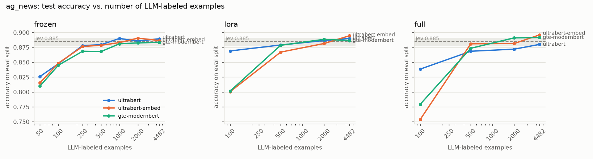

**banking77** (accuracy, Jev 0.797)

| backbone | method | n | silver-val | test | train s |
|---|---|---|---|---|---|
| ultrabert-embed | frozen | 4482 | 0.873 | 0.786 | 44 |
| gte-modernbert | frozen | 4482 | 0.869 | 0.780 | 43 |
| gte-modernbert | lora | 4482 | 0.865 | 0.788 | 92 |
| ultrabert | lora | 4482 | 0.851 | 0.775 | 149 |
| gte-modernbert | full | 4482 | 0.851 | 0.792 | 77 |
| ultrabert-embed | lora | 4482 | 0.841 | 0.786 | 144 |
| ultrabert-embed | full | 4482 | 0.831 | 0.780 | 79 |
| ultrabert | full | 4482 | 0.823 | 0.772 | 81 |
| ultrabert | frozen | 4482 | 0.809 | 0.749 | 48 |

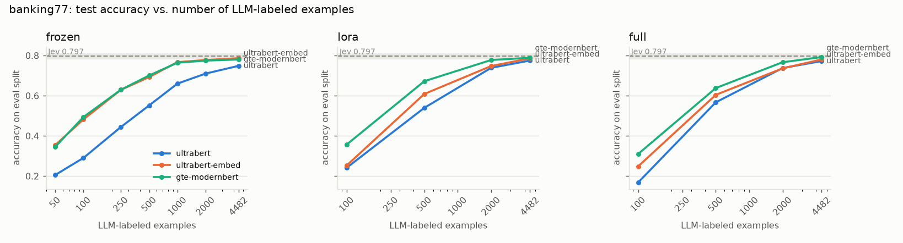

**boolq** (accuracy, Jev 0.913)

| backbone | method | n | silver-val | test | train s |
|---|---|---|---|---|---|
| ultrabert | full | 4482 | 0.783 | 0.812 | 297 |
| ultrabert | lora | 4482 | 0.773 | 0.801 | 515 |
| ultrabert-embed | full | 4482 | 0.761 | 0.772 | 313 |
| ultrabert-embed | lora | 4482 | 0.743 | 0.783 | 511 |
| gte-modernbert | lora | 4482 | 0.677 | 0.663 | 337 |
| gte-modernbert | full | 4482 | 0.643 | 0.684 | 660 |
| gte-modernbert | frozen | 4482 | 0.620 | 0.617 | 13 |
| ultrabert | frozen | 1000 | 0.612 | 0.586 | 11 |
| ultrabert-embed | frozen | 100 | 0.606 | 0.610 | 0 |

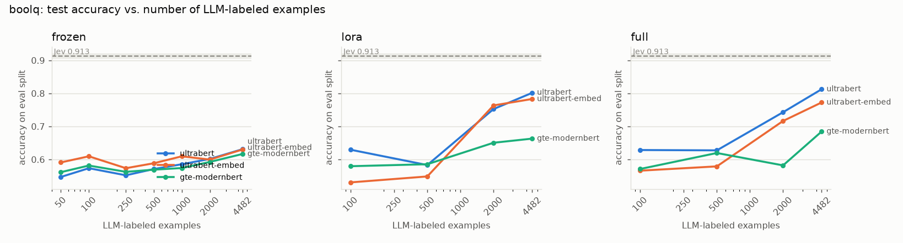

**clinc150** (accuracy, Jev 0.895)

| backbone | method | n | silver-val | test | train s |
|---|---|---|---|---|---|
| ultrabert-embed | frozen | 4482 | 0.908 | 0.853 | 53 |
| gte-modernbert | frozen | 4482 | 0.908 | 0.864 | 55 |
| gte-modernbert | full | 4482 | 0.908 | 0.863 | 78 |
| gte-modernbert | lora | 4482 | 0.902 | 0.879 | 82 |
| ultrabert-embed | full | 4482 | 0.896 | 0.853 | 82 |
| ultrabert | full | 4482 | 0.890 | 0.851 | 79 |
| ultrabert-embed | lora | 4482 | 0.873 | 0.855 | 141 |
| ultrabert | lora | 4482 | 0.863 | 0.837 | 130 |
| ultrabert | frozen | 4482 | 0.839 | 0.782 | 70 |

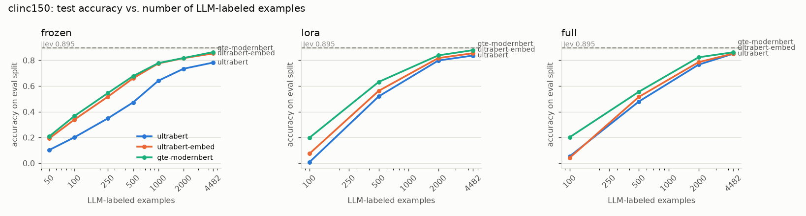

**emotion** (accuracy, Jev 0.585)

| backbone | method | n | silver-val | test | train s |
|---|---|---|---|---|---|
| gte-modernbert | full | 4482 | 0.783 | 0.596 | 104 |
| gte-modernbert | lora | 4482 | 0.767 | 0.581 | 148 |
| ultrabert | full | 4482 | 0.765 | 0.593 | 166 |
| ultrabert-embed | lora | 4482 | 0.761 | 0.576 | 130 |
| ultrabert | lora | 4482 | 0.757 | 0.595 | 132 |
| ultrabert-embed | full | 2000 | 0.745 | 0.609 | 73 |
| gte-modernbert | frozen | 2000 | 0.719 | 0.571 | 10 |
| ultrabert-embed | frozen | 4482 | 0.717 | 0.556 | 26 |
| ultrabert | frozen | 4482 | 0.602 | 0.539 | 110 |

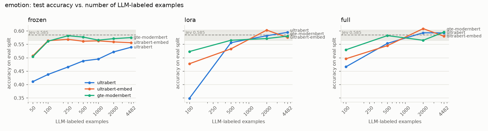

**financial_phrasebank** (accuracy, Jev 0.730)

| backbone | method | n | silver-val | test | train s |
|---|---|---|---|---|---|
| ultrabert-embed | full | 3470 | 0.876 | 0.840 | 114 |
| ultrabert | lora | 3470 | 0.870 | 0.842 | 112 |
| ultrabert-embed | lora | 3470 | 0.863 | 0.813 | 100 |
| gte-modernbert | full | 500 | 0.855 | 0.797 | 30 |
| gte-modernbert | lora | 2000 | 0.850 | 0.828 | 52 |
| ultrabert | full | 2000 | 0.850 | 0.814 | 38 |
| ultrabert-embed | frozen | 1000 | 0.839 | 0.799 | 2 |
| gte-modernbert | frozen | 2000 | 0.829 | 0.773 | 16 |
| ultrabert | frozen | 3470 | 0.803 | 0.747 | 73 |

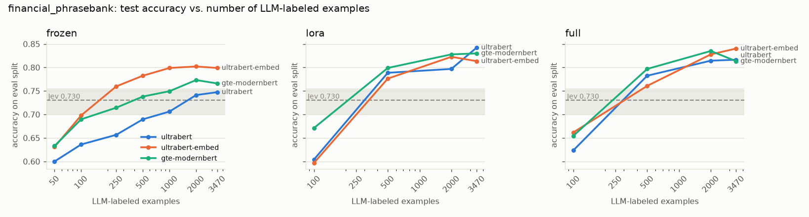

**helpsteer2** (spearman, Jev 0.412)

| backbone | method | n | silver-val | test | train s |
|---|---|---|---|---|---|
| ultrabert | lora | 4482 | 0.590 | 0.193 | 769 |
| ultrabert | full | 4482 | 0.528 | 0.171 | 437 |
| ultrabert-embed | full | 4482 | 0.511 | 0.136 | 450 |
| gte-modernbert | lora | 4482 | 0.475 | 0.141 | 419 |
| ultrabert-embed | lora | 4482 | 0.450 | 0.154 | 594 |
| ultrabert | frozen | 4482 | 0.420 | 0.137 | 111 |
| gte-modernbert | full | 4482 | 0.415 | 0.109 | 351 |
| ultrabert-embed | frozen | 4482 | 0.389 | 0.104 | 81 |
| gte-modernbert | frozen | 4482 | 0.312 | 0.098 | 94 |

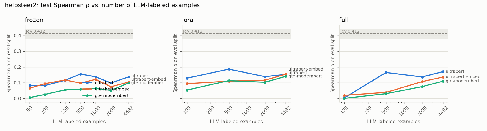

**paws** (accuracy, Jev 0.850)

| backbone | method | n | silver-val | test | train s |
|---|---|---|---|---|---|
| ultrabert | full | 4482 | 0.867 | 0.851 | 116 |
| ultrabert | lora | 4482 | 0.859 | 0.865 | 131 |
| ultrabert-embed | lora | 4482 | 0.815 | 0.809 | 129 |
| ultrabert-embed | full | 4482 | 0.813 | 0.827 | 184 |
| gte-modernbert | lora | 4482 | 0.801 | 0.767 | 100 |
| gte-modernbert | full | 4482 | 0.739 | 0.707 | 108 |
| ultrabert | frozen | 4482 | 0.729 | 0.681 | 28 |
| ultrabert-embed | frozen | 4482 | 0.604 | 0.549 | 12 |
| gte-modernbert | frozen | 4482 | 0.562 | 0.526 | 17 |

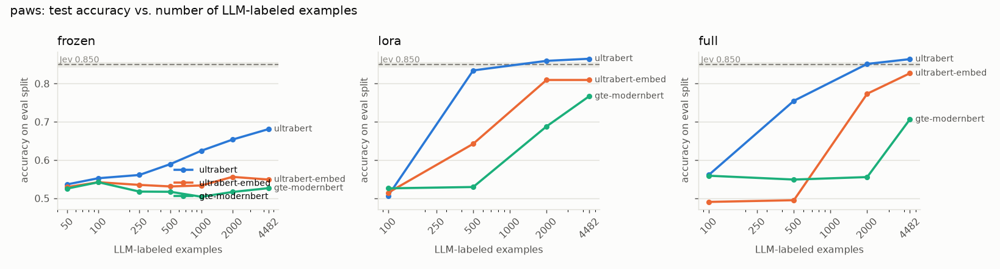

**prompt_injections** (accuracy, Jev 0.741)

| backbone | method | n | silver-val | test | train s |
|---|---|---|---|---|---|
| ultrabert-embed | full | 473 | 1.000 | 0.810 | 17 |
| ultrabert | frozen | 100 | 0.963 | 0.828 | 0 |
| gte-modernbert | full | 473 | 0.963 | 0.750 | 34 |
| ultrabert | lora | 100 | 0.960 | 0.793 | 14 |
| ultrabert-embed | lora | 473 | 0.960 | 0.793 | 15 |
| gte-modernbert | lora | 473 | 0.960 | 0.836 | 23 |
| ultrabert | full | 473 | 0.960 | 0.819 | 13 |
| ultrabert-embed | frozen | 100 | 0.880 | 0.733 | 0 |
| gte-modernbert | frozen | 250 | 0.870 | 0.724 | 0 |

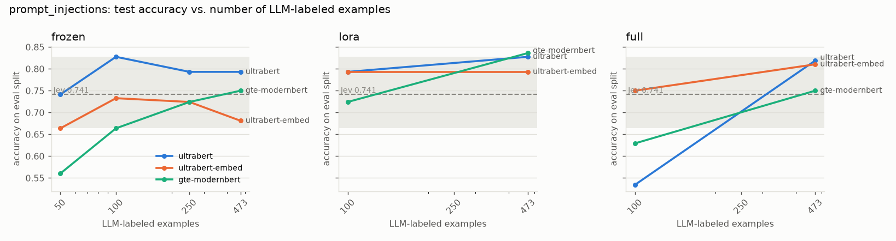

**sms_spam** (f1, Jev 0.938)

| backbone | method | n | silver-val | test | train s |
|---|---|---|---|---|---|
| ultrabert-embed | frozen | 2499 | 0.977 | 0.922 | 7 |
| gte-modernbert | lora | 2499 | 0.977 | 0.922 | 48 |
| gte-modernbert | full | 2499 | 0.977 | 0.930 | 39 |
| ultrabert | full | 2000 | 0.977 | 0.904 | 73 |
| ultrabert-embed | full | 2000 | 0.977 | 0.927 | 56 |
| ultrabert | frozen | 2499 | 0.966 | 0.889 | 8 |
| ultrabert-embed | lora | 2499 | 0.966 | 0.916 | 75 |
| gte-modernbert | frozen | 2499 | 0.955 | 0.910 | 3 |
| ultrabert | lora | 2000 | 0.953 | 0.909 | 167 |

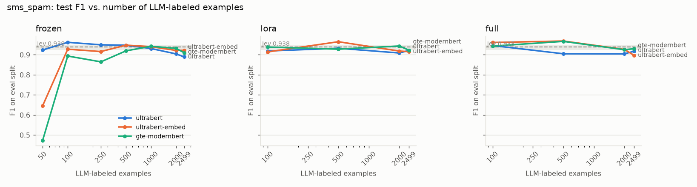

**sst5** (argmax_accuracy, Jev 0.579)

| backbone | method | n | silver-val | test | train s |
|---|---|---|---|---|---|
| gte-modernbert | lora | 4482 | 0.902 | 0.544 | 147 |
| gte-modernbert | full | 4482 | 0.901 | 0.560 | 76 |
| ultrabert-embed | lora | 4482 | 0.897 | 0.550 | 139 |
| ultrabert-embed | full | 4482 | 0.894 | 0.554 | 91 |
| ultrabert | full | 4482 | 0.893 | 0.524 | 103 |
| ultrabert | lora | 4482 | 0.888 | 0.542 | 139 |
| ultrabert-embed | frozen | 4482 | 0.877 | 0.501 | 59 |
| gte-modernbert | frozen | 4482 | 0.848 | 0.496 | 60 |
| ultrabert | frozen | 4482 | 0.837 | 0.470 | 103 |

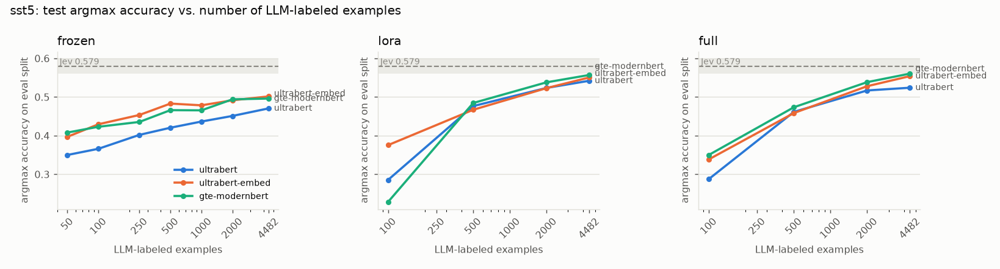

**stsb** (spearman, Jev 0.890)

| backbone | method | n | silver-val | test | train s |
|---|---|---|---|---|---|
| ultrabert | lora | 4482 | 0.882 | 0.883 | 150 |
| ultrabert | full | 4482 | 0.867 | 0.890 | 85 |
| ultrabert-embed | lora | 4482 | 0.865 | 0.866 | 179 |
| ultrabert-embed | full | 4482 | 0.864 | 0.877 | 88 |
| gte-modernbert | full | 4482 | 0.836 | 0.866 | 68 |
| gte-modernbert | lora | 4482 | 0.822 | 0.851 | 1801 |
| ultrabert | frozen | 4482 | 0.804 | 0.804 | 111 |
| ultrabert-embed | frozen | 4482 | 0.757 | 0.765 | 84 |
| gte-modernbert | frozen | 4482 | 0.720 | 0.740 | 131 |

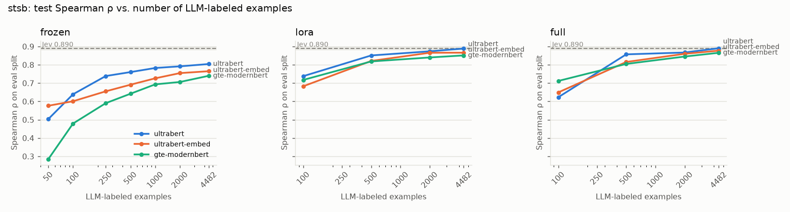

**summeval** (group_spearman, Jev 0.554)

| backbone | method | n | silver-val | test | train s |
|---|---|---|---|---|---|
| ultrabert | lora | 1138 | 0.676 | 0.573 | 223 |
| ultrabert-embed | full | 1138 | 0.622 | 0.497 | 145 |
| ultrabert | full | 1138 | 0.602 | 0.481 | 133 |
| ultrabert-embed | lora | 1138 | 0.561 | 0.543 | 232 |
| ultrabert | frozen | 1138 | 0.513 | 0.407 | 44 |
| gte-modernbert | lora | 1138 | 0.396 | 0.087 | 151 |
| gte-modernbert | full | 1138 | 0.355 | 0.060 | 116 |
| ultrabert-embed | frozen | 1000 | 0.348 | 0.212 | 19 |
| gte-modernbert | frozen | 1000 | 0.304 | -0.108 | 20 |

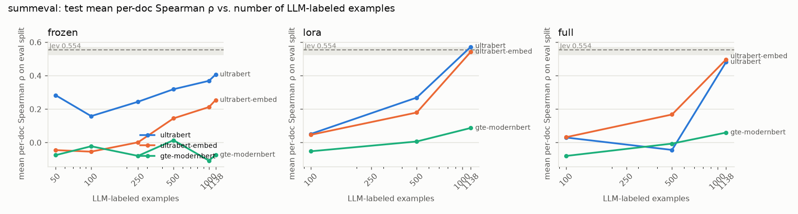

**toxic_chat** (f1, Jev 0.786)

| backbone | method | n | silver-val | test | train s |
|---|---|---|---|---|---|
| ultrabert | lora | 4482 | 0.697 | 0.694 | 171 |
| ultrabert-embed | lora | 4482 | 0.656 | 0.669 | 262 |
| ultrabert | full | 2000 | 0.632 | 0.691 | 99 |
| ultrabert-embed | full | 4482 | 0.618 | 0.639 | 152 |
| gte-modernbert | frozen | 4482 | 0.596 | 0.622 | 8 |
| gte-modernbert | lora | 500 | 0.594 | 0.553 | 43 |
| ultrabert-embed | frozen | 4482 | 0.586 | 0.618 | 9 |
| ultrabert | frozen | 4482 | 0.566 | 0.545 | 12 |
| gte-modernbert | full | 4482 | 0.549 | 0.544 | 130 |

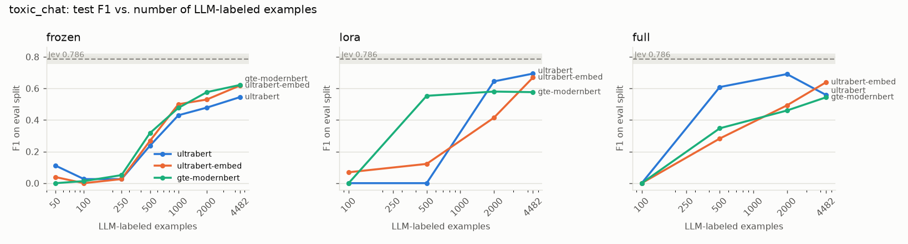

**toxigen** (accuracy, Jev 0.878)

| backbone | method | n | silver-val | test | train s |
|---|---|---|---|---|---|
| ultrabert-embed | lora | 4482 | 0.902 | 0.819 | 67 |
| ultrabert | lora | 4482 | 0.886 | 0.807 | 130 |
| gte-modernbert | lora | 4482 | 0.884 | 0.812 | 119 |
| ultrabert-embed | full | 4482 | 0.876 | 0.802 | 90 |
| gte-modernbert | full | 4482 | 0.871 | 0.807 | 62 |
| gte-modernbert | frozen | 4482 | 0.867 | 0.779 | 20 |
| ultrabert | full | 4482 | 0.865 | 0.794 | 107 |
| ultrabert-embed | frozen | 4482 | 0.859 | 0.816 | 14 |
| ultrabert | frozen | 4482 | 0.849 | 0.757 | 11 |

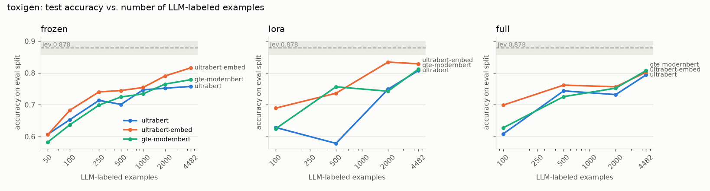

## Multi-dimension rubric tasks (silver labels, one model per dimension)

| task | dimension | ours | Jev (published, where reported) |
|---|---|---|---|
| helpsteer2 | helpfulness | 0.194 | 0.399 |
| helpsteer2 | correctness | 0.196 | 0.369 |
| helpsteer2 | coherence | 0.188 | – |
| helpsteer2 | complexity | 0.484 | – |
| helpsteer2 | verbosity | 0.606 | – |
| helpsteer2 | **mean** | **0.334** | **0.412** |
| summeval | coherence | 0.497 | 0.639 |
| summeval | consistency | 0.452 | – |
| summeval | fluency | 0.205 | 0.495 |
| summeval | relevance | 0.366 | – |
| summeval | **mean** | **0.380** | **0.554** |

## Synthetic data only (no real texts)

Examples generated by the labeler LLM from the question spec alone; `guided` additionally shows the generator 20 real labeled examples (never trained on).

| task | variant | n train | metric | ours (95% CI) | Jev |
|---|---|---|---|---|---|
| prompt_injections | synthetic | 829 | accuracy | 0.560 (0.474–0.647) | 0.741 |
| prompt_injections | synthetic_guided | 878 | accuracy | 0.741 (0.655–0.819) | 0.741 |

## Secondary heads (same recipe as the primary head)

| task | head | accuracy/F1 | Spearman | ECE |
|---|---|---|---|---|
| helpsteer2 | correctness | – | 0.196 | – |
| helpsteer2 | coherence | – | 0.188 | – |
| helpsteer2 | complexity | – | 0.484 | – |
| helpsteer2 | verbosity | – | 0.606 | – |
| summeval | consistency | – | 0.432 | – |
| summeval | fluency | – | 0.085 | – |
| summeval | relevance | – | 0.381 | – |
| toxic_chat | jailbreak | 0.836 | – | 0.001 |
| toxigen | toxicity | – | 0.755 | – |

## Spend

OpenRouter spend recorded by the ledger so far: **$5.77** (cap $15; experiments budget $20).
